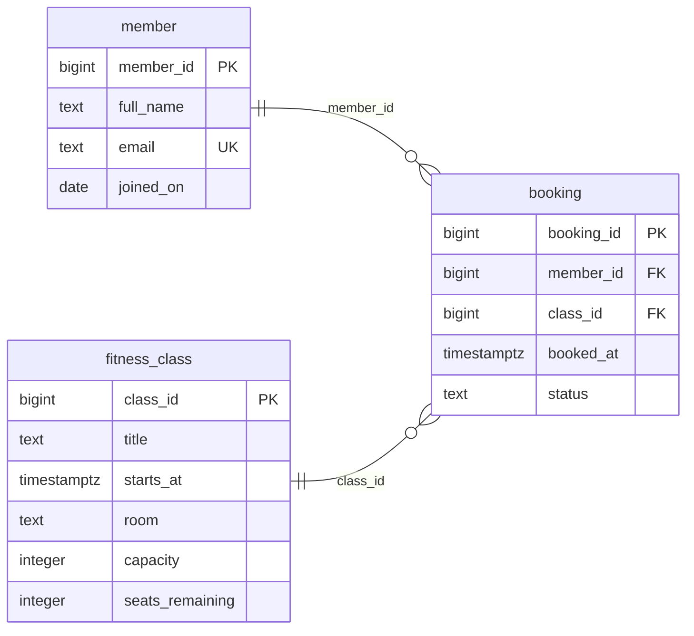

# Gym and Fitness Centre Management System — Entity Relationship diagram

PK(Primary Key) uniquely identifies a record; FK(Foreign Key) links to another table; UK(Unique Key) marks a single-field unique value. The relationship ends show exactly one, zero or one, or zero or many records. Composite unique keys and conditional rules are listed in the schema and design.

[Diagram image](../images/Adekunle_Sholabomi_301901541_ER_Diagram.png)
